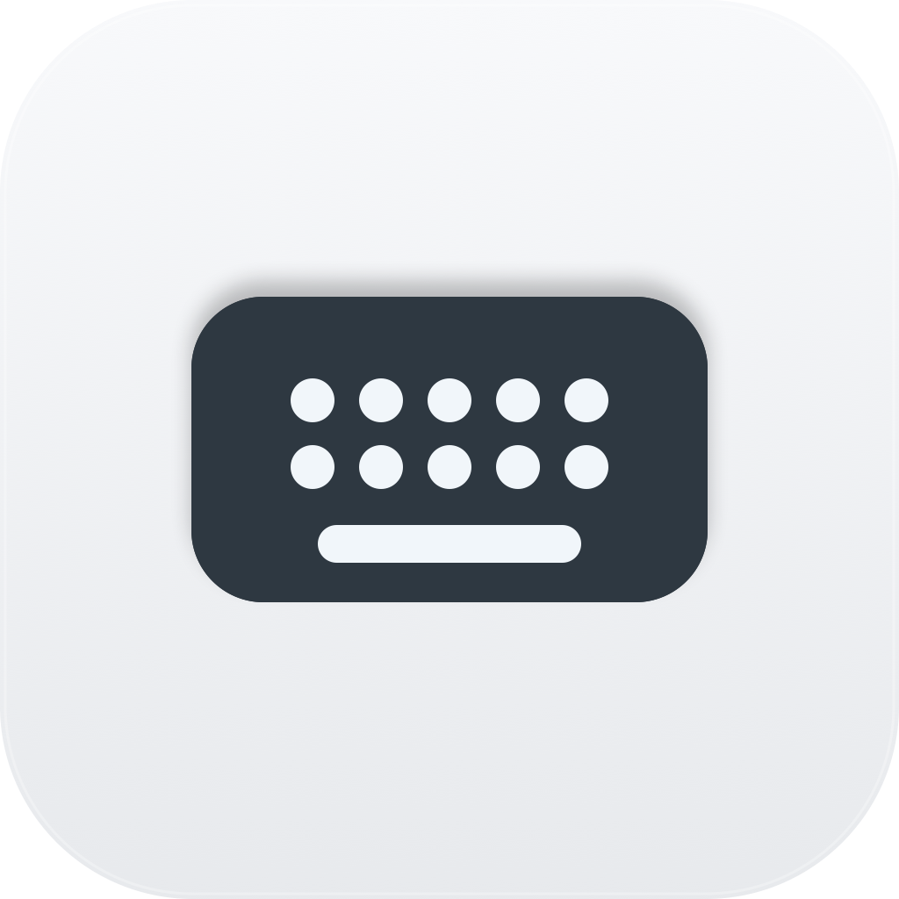

<p align="center">
  <picture>
    <source media="(prefers-color-scheme: dark)" srcset="Design/AppIcon/Previews/typelock-icon-dark.png">
    <source media="(prefers-color-scheme: light)" srcset="Design/AppIcon/Previews/typelock-icon-default.png">
    
  </picture>
</p>

<h1 align="center">TypeLock</h1>

<p align="center">TypeLock is a native macOS input-method manager. It applies per-app launch and activation rules, browser-domain rules, and terminal-program rules, with an optional on-screen indicator, per-input-method shortcuts, exclusions, and configuration backup.</p>

<p align="center">
  <a href="https://swift.org"></a>
  <a href="https://www.apple.com/macos/"></a>
  <a href="LICENSE"></a>
  <a href="https://github.com/zbl-jerry/TypeLock/releases"></a>
  <a href="https://github.com/zbl-jerry/TypeLock/pulls"></a>
</p>

<p align="center">🇨🇳 <a href="README.zh-CN.md">简体中文</a> · 🇺🇸 <strong>English</strong></p>

## ✨ Features

- **Per-app rules with two timings.** Each app can use a different input source when it launches and when it becomes active again. Rules can inherit the global default, disable switching, remember the last input source, or select a fixed input source.
- **Browser-domain rules.** Match exact domains, domain suffixes, or full-URL regular expressions. Rules apply when the frontmost browser reports a matching URL.
- **Terminal-program rules.** Choose an input source for the program running in the focused terminal pane, such as `nvim`, `ssh`, or `claude`.
- **Input-source indicator.** Show the current input source near the text caret, the mouse, or a screen edge. Configure duration, nine alignments, spacing, size, style, Caps Lock state, always-on display, and per-input-source labels and colors.
- **Global shortcuts.** Assign a keyboard shortcut to any input source, with conflict detection and a shortcut recorder.
- **Exclusions.** Keep separate exclusion lists for automatic switching and indicator feedback.
- **Reliability tools.** Fix the macOS input-source desynchronization with a focus-settling repair, and optionally disable the macOS 14 experimental text cursor when it causes typing or cursor lag.
- **Configuration backup.** Export and import all rules and preferences as JSON, with merge or replace modes.
- **Local-first.** Rules, statistics, and diagnostics stay on the Mac. Updates use Sparkle and a signed appcast.

## 🔀 Switching Precedence

TypeLock evaluates the following order for each foreground event:

1. Switching exclusion for the app.
2. Browser rule matching the frontmost browser URL.
3. Terminal rule matching the focused terminal program.
4. Per-app launch rule (first foreground after launch) or activation rule (returning to the foreground).
5. Global launch or activation strategy.
6. No automatic switch.

Browser rules use the page URL reported by the frontmost browser. TypeLock does not implement a separate “address bar focused” rule.

## 🖥️ Settings

The settings window contains:

- **General** — launch at login, launch input source, global default rule, data version, configuration backup.
- **App Rules** — launch and activation rules per app.
- **Indicator** — visibility, change-only mode, cursor preference, duration, position, cursor anchoring, alignment, spacing, style, size, Caps Lock, always-on, and per-input-source appearance.
- **Hot Keys** — global shortcuts per input source.
- **Browser & Domains** — exact-domain, suffix, and URL-regex rules.
- **Terminal Rules** — program-to-input-source rules.
- **Exclusions** — separate switching and indicator lists.
- **Troubleshooting** — permission status, CJKV focus repair, cursor lag fix.
- **About** — version, project links, issue reporting, beta updates.

## 🌐 Browser Support

TypeLock reads the active URL from:

- Safari and Safari Technology Preview
- Chrome, Chromium, and Thorium
- Edge
- Firefox, Firefox Developer Edition, and Firefox Nightly
- Brave, Brave Beta, and Brave Nightly
- Arc, Vivaldi, Opera, Zen, Dia, Helium, Comet, Aside, and Whale

If a browser does not expose its URL through Accessibility, TypeLock falls back to the app rule.

## ⌨️ Terminal Support

- **Terminal** and **iTerm2** — focused tty via AppleScript.
- **tmux** — maps the terminal client tty to the active pane tty.
- **WezTerm** — active pane via `wezterm cli list --format json`.
- **Ghostty**, **Alacritty**, and **zellij** are not adapted yet; they fall back to the terminal app rule.

## 🔐 Permissions

| Permission | Used for |
|---|---|
| Accessibility | Reading browser URLs, caret position, terminal pane focus, and always-on indicator placement |
| Automation / Apple Events | Asking Terminal or iTerm2 for the focused tty |
| Login Items | Launch at login |

TypeLock does not request Screen Recording and does not upload rules or usage data.

The optional Cursor Helper is a separate executable. It may need its own Accessibility grant; when unavailable, TypeLock falls back to direct Accessibility reads and then to mouse/screen placement.

## 💾 Local Data

Configuration is stored under:

```text
~/Library/Application Support/io.github.zbl-jerry.TypeLock/
```

Files include app rules, fallback rules, browser rules, terminal rules, exclusions, indicator preferences, hotkey preferences, reliability preferences, and switch statistics. Backup export contains rules and preferences; statistics are excluded by default.

## 📦 Installation

TypeLock is distributed as a Universal Binary `.zip` from [GitHub Releases](https://github.com/zbl-jerry/TypeLock/releases). There is no Homebrew cask. Builds are currently unsigned and not notarized.

1. Download the latest build from Releases.
2. Move `TypeLock.app` to Applications.
3. Control-click the app, choose **Open**, and confirm.
4. If macOS still blocks it, use **System Settings → Privacy & Security → Open Anyway**.
5. Grant the permissions described above.

## 🧭 Usage

1. Launch TypeLock. Its icon appears in the menu bar.
2. Open the menu for the current app, running apps, configured apps, missing apps, ignored apps, switch statistics, and global settings.
3. Open **Settings…** for the full rule and indicator editor.
4. Configure launch and activation rules per app, then add browser, terminal, and exclusion rules as needed.
5. Use **Export Configuration** before changing many rules, or to move settings to another Mac.

## 🚧 Known Limitations

- No per-app “force English punctuation” mode.
- No per-app function-key mode.
- Spotlight, Alfred, and Raycast floating panels are not specially arbitrated.
- Ghostty, Alacritty, and zellij terminal programs are not detected.
- Browser matching is URL/domain based; there is no separate address-bar-focus rule.
- Cursor Helper is best-effort and requires its own Accessibility permission.
- Japanese, Korean, and Persian include translated common UI; some technical and error strings still fall back to English.
- Releases are unsigned and not notarized.

## 🧰 Tech Stack

- [The Composable Architecture](https://github.com/pointfreeco/swift-composable-architecture) `1.26.0`
- [Sharing](https://github.com/pointfreeco/swift-sharing) `2.9.1`
- [Sparkle](https://github.com/sparkle-project/Sparkle) `2.9.4`
- CasePaths, Dependencies `1.12.0`, and PerceptionCore
- [Tuist](https://github.com/tuist/tuist) for project generation

## 🧪 Development

### Requirements

- Xcode 26.3+
- Swift 5.9 language mode
- macOS 14.0+
- [just](https://github.com/casey/just)
- [Tuist](https://github.com/tuist/tuist)
- [SwiftFormat](https://github.com/nicklockwood/SwiftFormat) `0.62.1` (pinned in `.swiftformat-version`)

### Toolchain Pins

- CI pins **Xcode 26.3**; `just test` refuses older Xcode versions.
- `swift-dependencies` is pinned to **1.12.0** and transitive `swift-syntax` to **602.0.0** because newer releases require Swift 6.3.
- Do not bump these pins without moving the CI toolchain to a newer Xcode.

### Build and Test

```bash
sudo xcode-select -s /Applications/Xcode-26.3.0.app
tuist generate --no-open
just test
```

Run the formatting, unit-test, release-script, and license checks:

```bash
just check
```

### CI and Releases

- **Build** runs on every push to `dev` and on manual dispatch: tests, archives a Universal Binary, packages `TypeLock-macOS-universal.zip`, and uploads checksums as an artifact.
- **PR Checks** runs formatting, tests, release-script tests, and license checks on pull requests.
- **Release** runs from an annotated `vX.Y.Z` tag contained in `dev`, publishes the zip, checksums, signed Sparkle appcast, and an Artifact Attestation.
- `main` is a read-only history mirror; all TypeLock development, builds, and releases happen on `dev`.

## 🧱 Project Layout

```text
TypeLock/Sources/App              TCA features, dependencies, switch resolution
TypeLock/Sources/Core             models, storage, URL helpers
TypeLock/Sources/Services         input methods, browser/terminal, updates, reliability
TypeLock/Sources/UI               menu bar, settings, indicator
TypeLock/Sources/Migrations       schema version
TypeLockTests                     XCTest coverage
TypeLockCursorHelper              optional Accessibility helper
Documentation                     current product and architecture docs
```

## 🙏 Acknowledgments

- [SwitchKey](https://github.com/itsuhane/SwitchKey), an input method switcher for macOS
- The Swift and SwiftUI community
- Contributors and users who shared feedback
