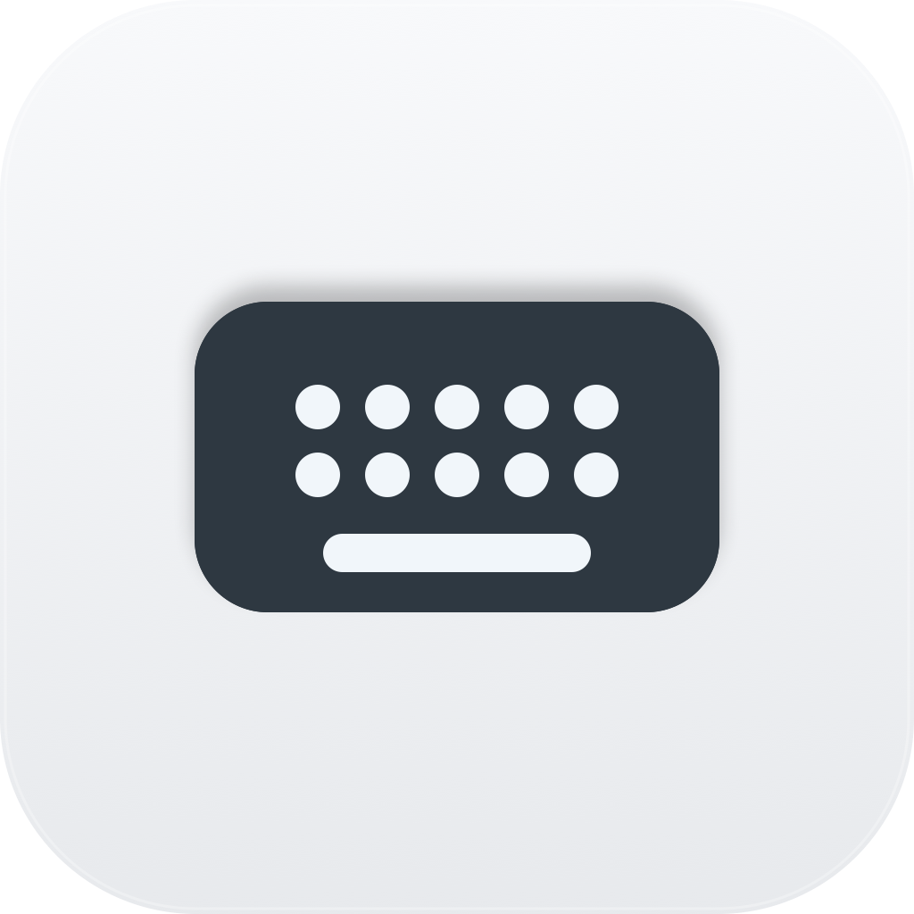

<p align="center">
  <picture>
    <source media="(prefers-color-scheme: dark)" srcset="Design/AppIcon/Previews/typelock-icon-dark.png">
    <source media="(prefers-color-scheme: light)" srcset="Design/AppIcon/Previews/typelock-icon-default.png">
    
  </picture>
</p>

<h1 align="center">TypeLock</h1>

<p align="center">TypeLock 是一款按 App 自动切换输入法的原生 macOS 菜单栏工具。为每个 App 选择输入法策略，设置未配置 App 的默认规则，并在前台 App 切换时自动切到对应输入法。</p>

<p align="center">
  <a href="https://swift.org"></a>
  <a href="https://www.apple.com/macos/"></a>
  <a href="LICENSE"></a>
  <a href="https://github.com/zbl-jerry/TypeLock/releases"></a>
  <a href="https://github.com/zbl-jerry/TypeLock/pulls"></a>
</p>

<p align="center">🇨🇳 <strong>简体中文</strong> · 🇺🇸 <a href="README.md">English</a></p>

> **Fork 说明：** TypeLock 是 [TypeSwitch](https://github.com/ygsgdbd/TypeSwitch) 的独立 fork，由 [zbl-jerry](https://github.com/zbl-jerry) 维护。`main` 分支用于追踪上游；`dev` 分支用于 TypeLock 的开发、构建和发布。

## ✨ 功能亮点

- **按 App 自动切换。** TypeLock 会监听当前前台 App，在你切换 App 时自动应用已保存的输入法规则，已忽略的 App 除外。
- **选择适合自己的切换方式。** 可让 App 继承默认规则、记住上次切换、指定输入法，或忽略不希望 TypeLock 管理的 App。
- **随时配置遇到的 App。** 可直接设置当前 App，从按配置状态分组的运行中 App 里选择，或在菜单栏中管理全部已保存规则。
- **保持规则与统计整洁。** 查找不存在 App 的规则、移除失效设置、查看成功切换次数，并按需清零统计。
- **融入日常工作流程。** 支持登录时打开、通过 Sparkle 静默检查更新、从“帮助与关于”访问项目与支持入口，以及使用 `Command + Q` 退出。

## 🪶 原生与轻量

- **真正原生。** TypeLock 的 App 业务代码使用 Swift 编写，并采用 SwiftUI 和 The Composable Architecture（TCA）架构。它基于 `MenuBarExtra` 与 `LSUIElement` 构建，不包含 Electron 运行时，也没有嵌入 WebView。
- **专注且轻量。** TypeLock 作为菜单栏工具运行，无需附带浏览器引擎或服务端组件。App 规则、默认规则和切换统计都保存在你的 Mac 上。
- **自然融入 macOS。** 界面会自动适配浅色与暗色模式。在 macOS 26 上，原生 SwiftUI 控件会在适用位置呈现系统提供的 Liquid Glass 外观；macOS 14 与 macOS 15 则保持各自的原生系统样式。TypeLock 不使用自定义视觉效果模拟 Liquid Glass。
- **同时支持新旧 Mac。** Release workflow 使用 Xcode 26.5，并验证每个发布版本都是同时支持 Apple Silicon 与 Intel Mac 的 Universal Binary。

## 💻 系统要求

- macOS 14.0 或更高版本
- 已启用的 macOS 键盘布局或输入法
- macOS 对应用激活监听、系统输入法切换和可选登录项所需的权限

## 📦 安装方法

TypeLock 以 Universal Binary `.zip` 的形式从 [GitHub Releases](https://github.com/zbl-jerry/TypeLock/releases) 发布，所有版本都由 `dev` 分支构建和发布。本 fork 不提供 Homebrew cask，发布版本未签名、未公证。

### 手动安装

1. 从 [Releases](https://github.com/zbl-jerry/TypeLock/releases) 下载最新构建。
2. 将 `TypeLock.app` 拖入“应用程序”文件夹。
3. 在“应用程序”中按住 Control 点击或右键点击 `TypeLock.app`，选择“打开”，然后确认打开。
4. 如果 macOS 仍然阻止运行，请打开“系统设置”→“隐私与安全性”，找到 TypeLock 的安全提示并选择“仍要打开”。
5. 授予 macOS 请求的系统权限。
6. TypeLock 会静默检查 GitHub Releases；发现新版本后，菜单会显示版本号，点击后才会打开更新窗口。

## 🧭 使用说明

1. 启动 TypeLock，键盘图标会出现在菜单栏中。
2. 打开菜单，用“当前应用”配置当前前台 App。
3. 用“运行中 · 未配置”为还没有规则的运行中 App 设置规则。
4. 用“运行中 · 已配置”和“全部已配置 App”查看并修改已有 App 规则。
5. 为每个 App 选择“默认”以继承兜底规则，或选择“记住上次切换”及指定输入法。
6. 选择“忽略此 App”可停止自动切换并将其从普通列表隐藏；可在“已忽略 App”中单项恢复或恢复全部，并还原忽略前的规则。
7. 用“未配置 App 的默认规则”设置没有单独规则的 App 的默认行为。
8. 按需查看“找不到的 App”和“切换统计”，清理缺失规则或查看成功切换次数。

## 🔒 隐私与权限

- App 规则、未配置 App 的默认规则和切换统计都存储在本地。
- 本仓库中没有服务端组件。
- TypeLock 会在启动时及运行期间定时访问 GitHub appcast 检查更新。后台检查只更新菜单状态，不会自动弹窗、下载或安装；点击“检查更新…”或“新版本 … 可用…”后才会打开 Sparkle 更新窗口。
- 输入法切换使用 macOS 系统输入源。
- “登录时打开”使用 macOS 登录项；必要时会回退到 LaunchAgent。

## 🧰 技术栈

本项目使用：

- [The Composable Architecture](https://github.com/pointfreeco/swift-composable-architecture) `1.26.0`：应用架构和状态管理
- [Sharing](https://github.com/pointfreeco/swift-sharing) `2.9.1`：基于文件的共享状态持久化
- [Sparkle](https://github.com/sparkle-project/Sparkle) `2.9.4`：静默自动检查、手动更新和 appcast 支持
- Point-Free 支持库：CasePaths、Dependencies、PerceptionCore
- [Tuist](https://github.com/tuist/tuist)：项目生成和构建配置

## 🧪 开发相关

### 环境要求

- Xcode 26.5+
- Swift 5.9+
- macOS 14.0+
- [just](https://github.com/casey/just)
- [Tuist](https://github.com/tuist/tuist)
- [SwiftFormat](https://github.com/nicklockwood/SwiftFormat)（版本由 `.swiftformat-version` 固定）
- [ImageMagick](https://imagemagick.org/)
- RTK（`rtk`，截图生成脚本需要）

### 构建步骤

安装所需开发工具：

```bash
brew install just swiftformat
brew tap tuist/tuist
brew install --formula tuist
```

克隆仓库并生成 Xcode 项目：

```bash
git clone https://github.com/zbl-jerry/TypeLock.git
cd TypeLock
git checkout dev
tuist generate
open TypeLock.xcworkspace
```

`main` 分支用于追踪上游 TypeSwitch，开发与发布都应在 `dev` 分支进行。

运行与 Pull Request 相同的格式检查和测试：

```bash
just check
```

如需重新生成内容固定且不包含用户真实规则、输入法或统计信息的 README 截图，请先为终端或 Codex 授予“屏幕与系统音频录制”和“辅助功能”权限，然后执行下面的命令。脚本使用隔离的 `TypeLockScreenshots` 演示副本，日常使用的 TypeLock 可以保持运行。

```bash
./script/generate_readme_screenshots.sh
```

### 持续集成

- **Build** workflow 会在每次推送到 `dev` 时自动运行，也支持手动 `workflow_dispatch`。它会生成 Xcode 项目、运行完整测试、归档 Universal Binary、打包 `TypeLock-macOS-universal.zip`，并将 zip 与 checksum 作为 GitHub Actions artifact 上传。
- **PR Checks** workflow 会在 Pull Request 上运行发布脚本测试、workflow lint、SwiftFormat 检查和单元测试。

### 发布流程

推送包含于 `dev`、格式严格为 `vX.Y.Z` 的 annotated tag 后，GitHub Actions 会构建正式版本：

```bash
git checkout dev
git tag -a v0.10.4 -m "TypeLock v0.10.4"
git push origin v0.10.4
```

发布 workflow 会校验标签属于 `origin/dev`、运行测试、构建 universal macOS app、打包 zip、发布 SHA-256 checksum、使用 EdDSA 签名 Sparkle `appcast.xml`、为发布 zip 生成 GitHub Artifact Attestation，并发布 GitHub Release。打 tag 前请先在 `CHANGELOG.md` 中添加对应的 `## vX.Y.Z` 章节。

不要重新触发或构建已经正式发布的 tag。如果发布运行失败，请在 Actions 页面仅重跑失败的任务，或执行：

```bash
FAILED_RUN_ID=123456789 # 替换为失败的 workflow run ID。
gh run rerun "$FAILED_RUN_ID" --failed --repo zbl-jerry/TypeLock
```

如果发布保护提示存在未完成的草稿 Release，请先检查它：

```bash
gh release view v0.10.0 --repo zbl-jerry/TypeLock --json isDraft,url,assets
```

仅在确认 `isDraft` 为 `true` 后，删除该草稿但保留 tag，然后仅重跑失败的任务：

```bash
gh release delete v0.10.0 --repo zbl-jerry/TypeLock --yes
FAILED_RUN_ID=123456789 # 替换为失败的 workflow run ID。
gh run rerun "$FAILED_RUN_ID" --failed --repo zbl-jerry/TypeLock
```

workflow 会拒绝重新构建或覆盖已完成的正式 Release。修复内容应使用新的 SemVer tag 发布。

下载发布 zip 后，可使用 GitHub CLI 验证其构建来源：

```bash
gh attestation verify TypeLock-macOS-universal.zip --repo zbl-jerry/TypeLock
```

## 🙏 致谢

TypeLock 是 [TypeSwitch](https://github.com/ygsgdbd/TypeSwitch) 的 fork，并受到以下项目和社区启发：

- [TypeSwitch](https://github.com/ygsgdbd/TypeSwitch)，上游的按 App 自动切换输入法工具
- [SwitchKey](https://github.com/itsuhane/SwitchKey)，一款 macOS 输入法切换工具
- Swift 和 SwiftUI 社区
- 提供反馈的贡献者和用户
